# Journal - 2026-10-10 - Day 12: The Week I Practised Being Chosen

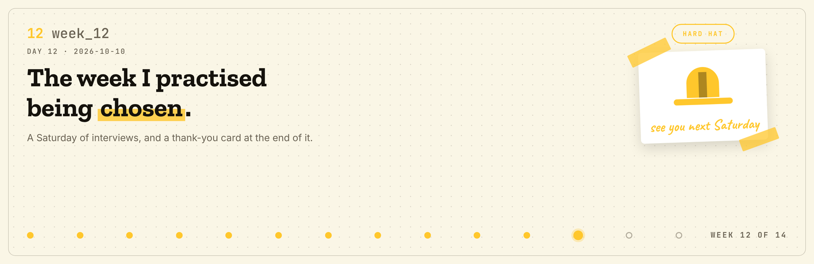

**FTW Foundation Batch 12 x Accenture, Data Engineering Track.**

  

## Today in one sentence

- Week 12 was silver and gold tables all week and then a Saturday with a dress code, where I spent the whole afternoon practising how to be chosen and ended it writing a thank-you card to the woman who chose me first.

---

Last entry said three Saturdays. Now it is two.

Monday to Friday was the quiet part. Silver and gold with Nadine, Bri, Sam and Tricia. 53 issues closed. Not all of them were on GitHub, and that is the honest version. Some of them were a team figuring out how to talk to each other at 11 p.m.

Then Saturday, the one with a dress code.

Short version: it was a day about being looked at.

<b>You: run log first, please</b>

 

| Step | When | What happened |
|---|---|---|
| 1 | Mon to Fri | Silver and gold tables with Buildabida. 53 issues closed |
| 2 | Sat, morning | Photoshoot. Shiena did Tricia's makeup, nobody did their own |
| 3 | Sat, morning | Ms. Lesley Anne B. Perez, financial literacy 101 |
| 4 | Sat, noon | Ms. Kamille Nepomuceno bought us pizza |
| 5 | Sat, afternoon | KadaKareer on interview confidence. Situation, task, action, result |
| 6 | Sat, afternoon | HR interview with Ms. Tina Bautista, with Maeve and Razz |
| 7 | Sat, afternoon | Technical interview with Ms. Kamille, with Nella, Sara and Cath |
| 8 | Sat, end of day | We wrote cards to the women who interviewed us when we applied |

Now the long version.

---

## What I learned

### 01 Silver and gold, and the issues that were not on GitHub

The build week itself went fine. We closed 53 issues against the October 10 milestone, which was silver and gold tables.

What I did not expect is how much of leading is the other kind of issue. The ones with no ticket. Who is stuck and not saying it. Who took on too much because it was faster than explaining. Whether the quiet in the group chat is focus or something else.

- [x] Silver tables matched and reconciled
- [x] Gold dimensions and facts with stable keys
- [x] 53 of 53 issues closed
- [ ] A way to spot the unticketed ones earlier

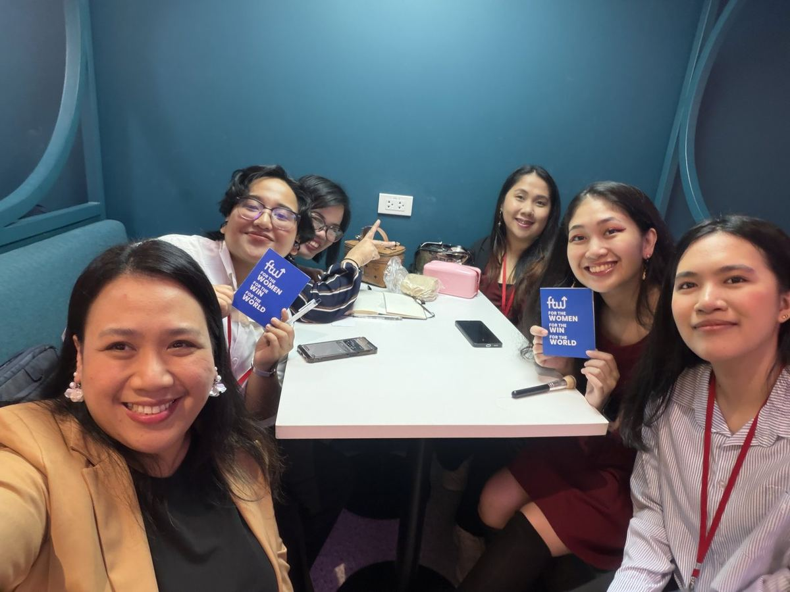

> [!NOTE]
> Receipts for the ticketed half: https://github.com/Buildabida/infra-project-monitoring

---

### 02 A Saturday with a dress code

Formal wear for today's day. We had a photoshoot in the morning, which mostly meant Shiena doing Tricia's makeup while the rest of us took selfies waiting our turn.

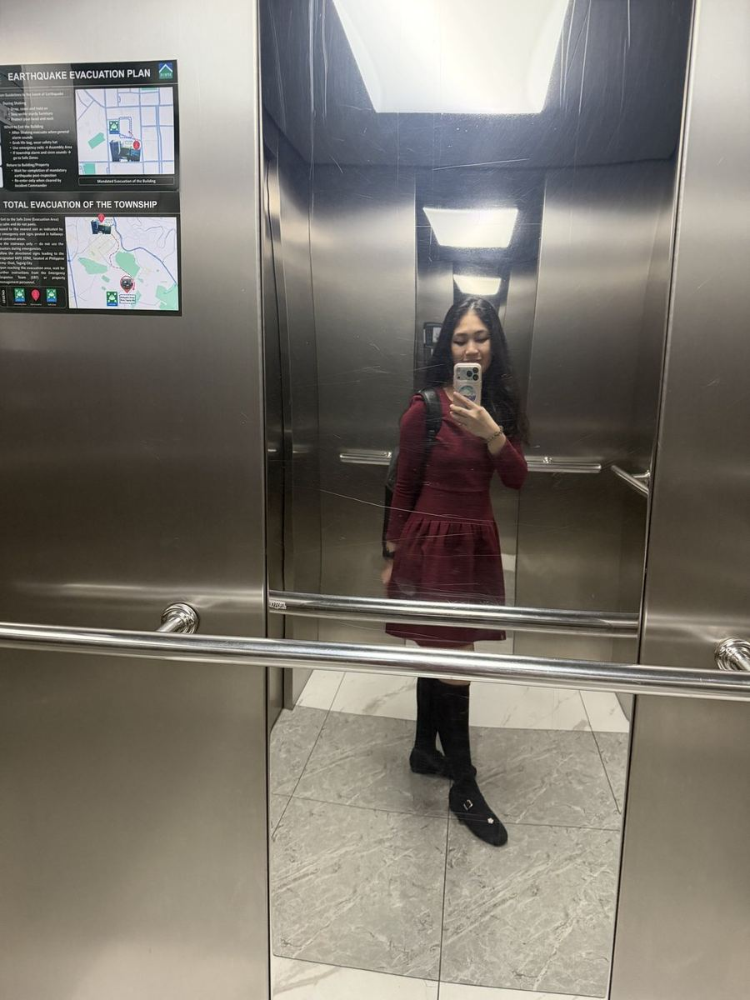

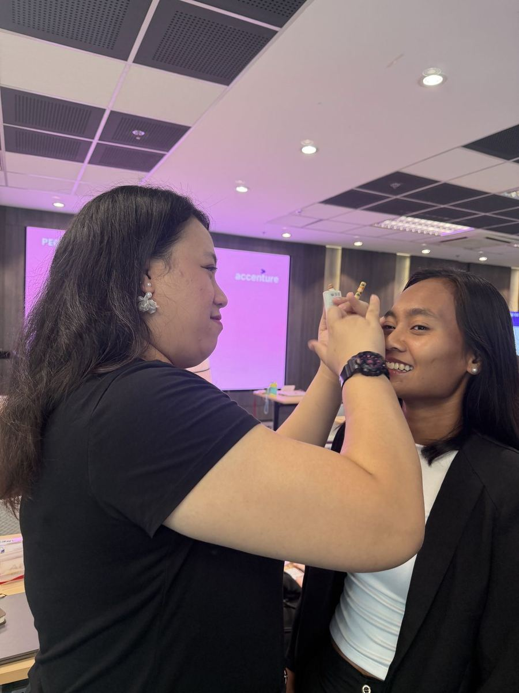

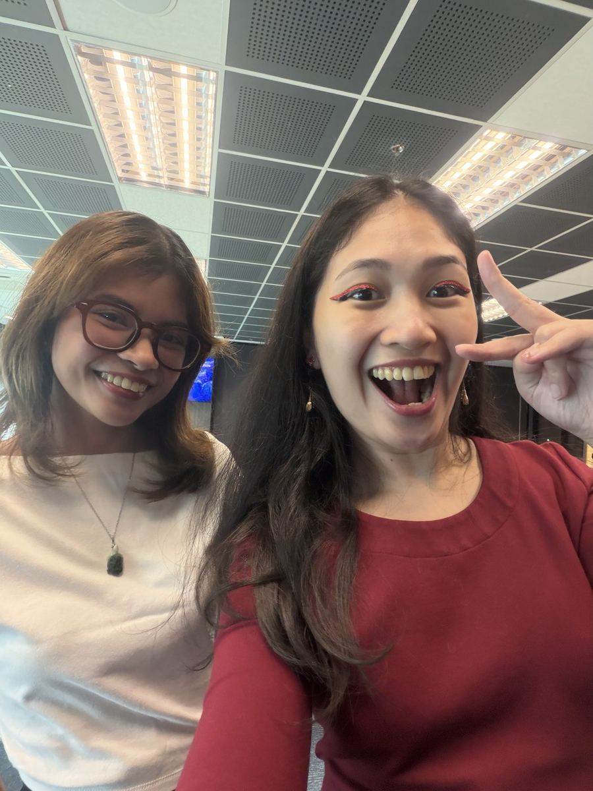

---

### 03 Financial literacy 101

Ms. Lesley Anne B. Perez gave us financial literacy 101. I am choosing to read the whole session as a preview. The day our careers get far enough along that money stops being the thing we worry about.

Manifesting it. WARN because I understood every slide and have applied approximately none of it yet.

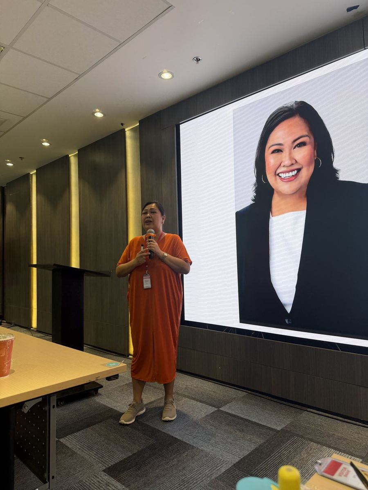

---

### 04 Lunch, which was a warning

Ms. Kamille Nepomuceno bought us pizza at noon. Very kind. Also, in hindsight, the kindest possible warning, because the entire afternoon was interviews.

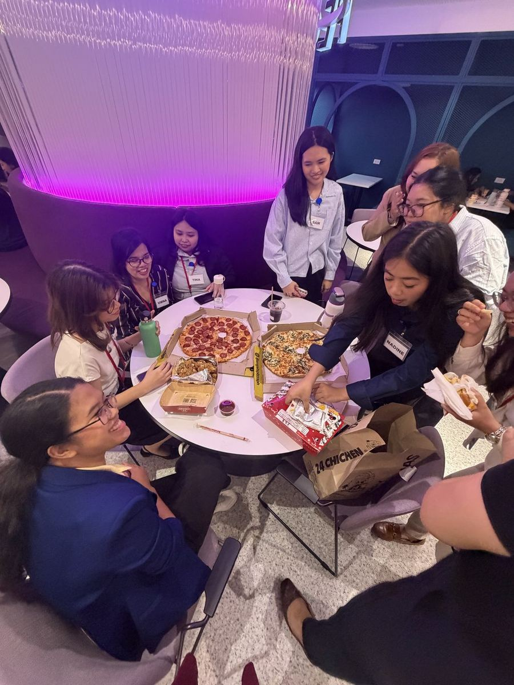

---

### 05 How to be in a room where someone is deciding about you

KadaKareer went first. The frame they gave us was situation, task, action, result. Say the situation, say what you were asked to do, say what you did, say what happened.

It sounds obvious written down. It is not obvious at all when somebody is looking at you and waiting.

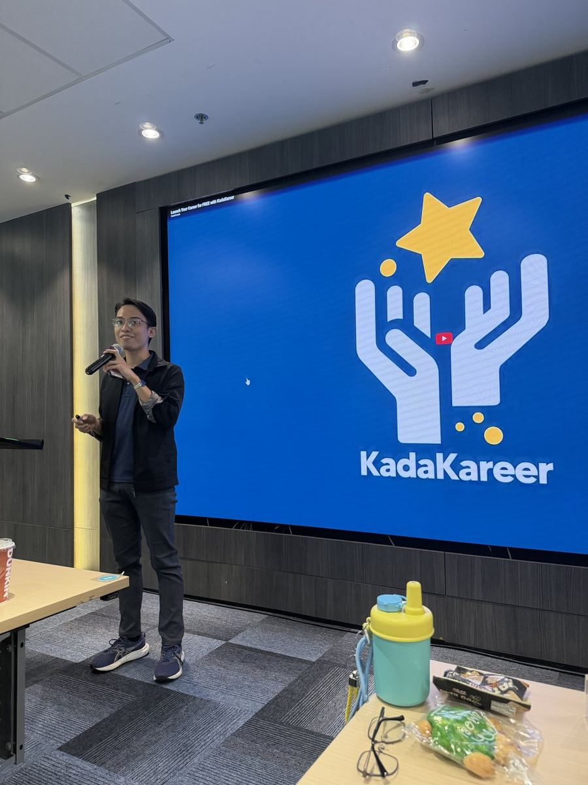

> [!IMPORTANT]
> The hardest part of STAR is the A. We are trained to say "we" and it feels rude to say "I". In an interview, "we" hides you.

---

### 06 The HR interview, and the line I keep repeating

Then the HR interview with Ms. Tina Bautista, sitting with Maeve and Razz.

Her note to me was short and it has not left since:

> Say what you did, not what the team did.

I lead a team. My instinct is to credit them. She is right that an interview is not the place for it, and I have been practising the difference ever since.

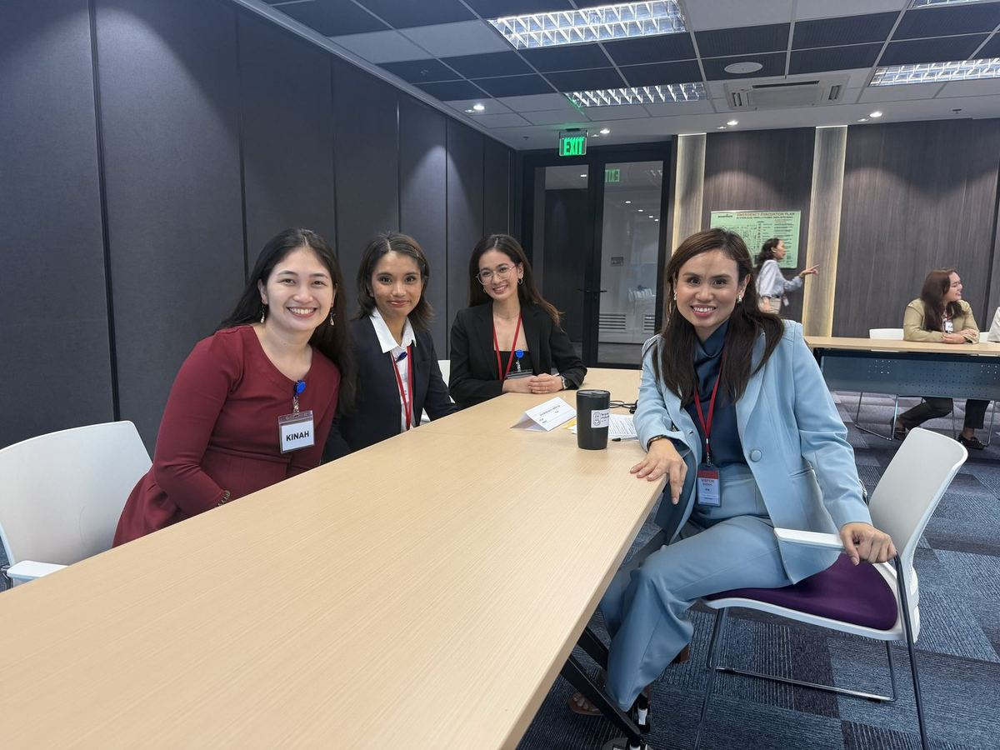

---

### 07 The technical one, in ten minutes, graded

Then Ms. Kamille again for the technical interview, with Nella, Sara and Cath. Ten minutes. Graded. And it finished with:

> Now explain it to your grandmother.

That is the actual test. Not whether you know what a medallion architecture is, but whether you can say it to someone who has never heard the word.

WARN, because I got through it and I am still chewing on my own answer.

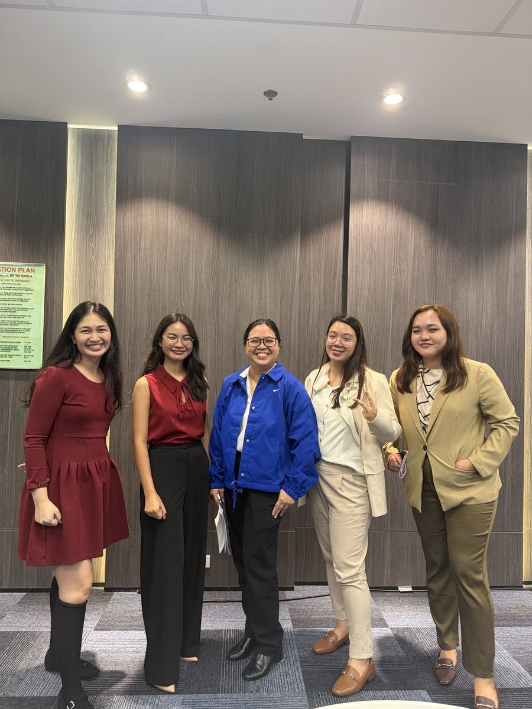

---

### 08 The card

At the end of all of it, they handed us pens and asked us to write cards to the women who interviewed us when we applied.

Mine went to Marife Zamora.

That is the part that got me. I spent a whole Saturday practising how to be chosen, and then someone handed me a pen and asked me to thank the person who chose me first.

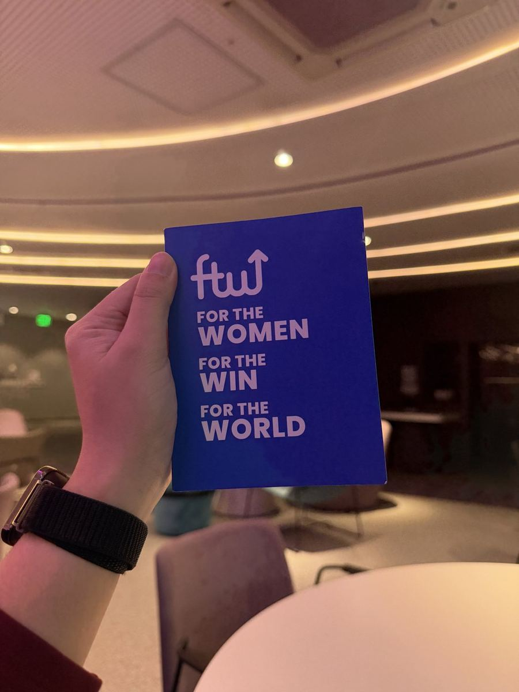

---

## Terms I am still learning

| Term | What I think it means today |
|---|---|
| STAR | Situation, task, action, result. A shape for answering, so you stop rambling |
| Behavioural interview | They are not testing the story. They are testing whether you did the thing |
| Gold layer | The tables a dashboard is allowed to touch. Stable keys, no surprises |

## What confused me

- Where the line sits between crediting my team and claiming my own work. Ms. Tina's answer is clear in an interview room. It is less clear in a standup.
- Whether "explain it to your grandmother" means simpler words or a different story altogether. I think it is the second one.

## One small next step

- [ ] Rewrite my three strongest capstone stories in STAR, in the first person, and time myself at two minutes each

## Git checkpoint

- [x] I created or updated a file
- [x] I wrote a commit
- [x] I pushed my changes

## Evidence from today

- Milestone "Oct 10: Silver and gold tables", 53 of 53 issues closed
- Day 12 schedule, Batch 12 weekly slides
- The card, which is not in any repo

## Reflection

Twelve weeks ago someone sat across from me and decided I could do this. I did not think about her much afterwards. There was too much in the way. SQL, then Databricks, then a capstone.

It took a pen and a blank card to remember she existed.

## Mood or meme

Formal wear, pizza, three interviews and a crying session. A normal Saturday.

---

<b>You: and the part that was not in the lessons</b>

 

The photoshoot. None of us do our own makeup and all of us wanted to look like we had it together. Shiena did Tricia's face and the rest of us queued up like it was a salon.

Nobody tells you that the dress-code Saturday is the one you remember.

<b>You: so how does this end</b>

 

Depends who you are.

- If you are Nadine, Bri, Sam or Tricia: 53 issues, and the ones that were not issues. Two Saturdays left.
- If you are Ms. Tina: I am still practising the I instead of the we.
- If you are Ms. Kamille: thank you for the pizza and for the ten hardest minutes of the day.
- If you are Ms. Lesley Anne: I will come back to the slides when I can afford to.
- If you are Marife Zamora: thank you for saying yes to me twelve weeks ago.
- If you are me at 1 a.m.: two Saturdays. Silver is done, gold is next. Pet the cat. Go to sleep.

The rest of my commits will live here.
