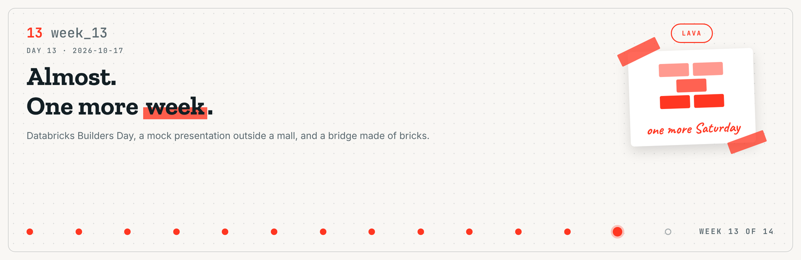
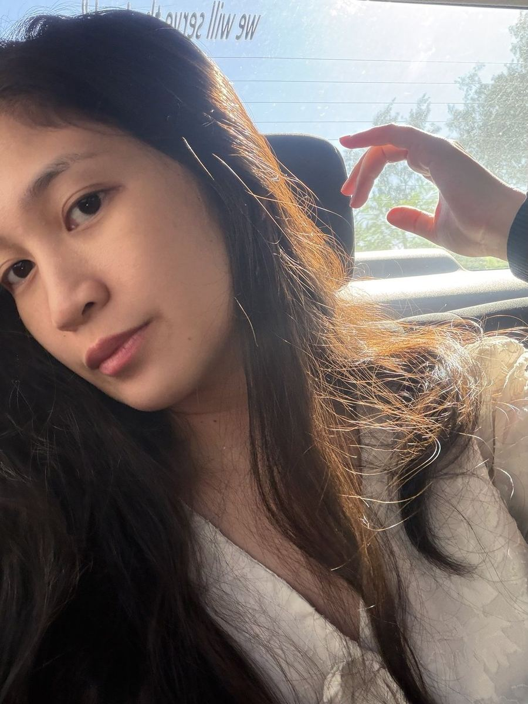
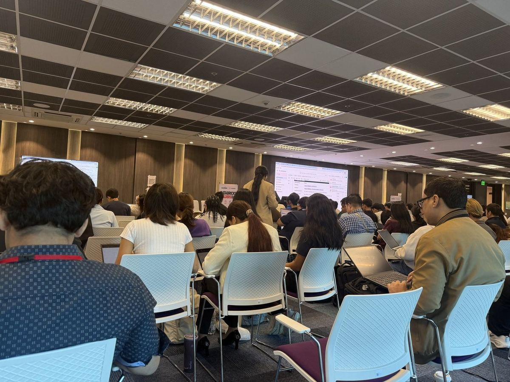
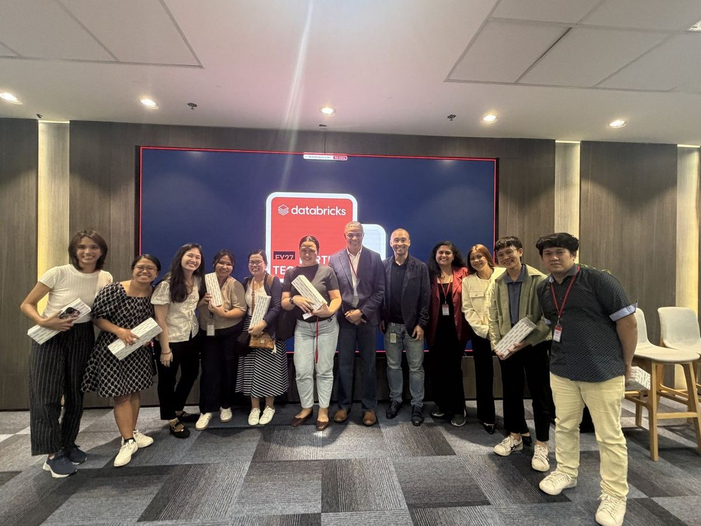
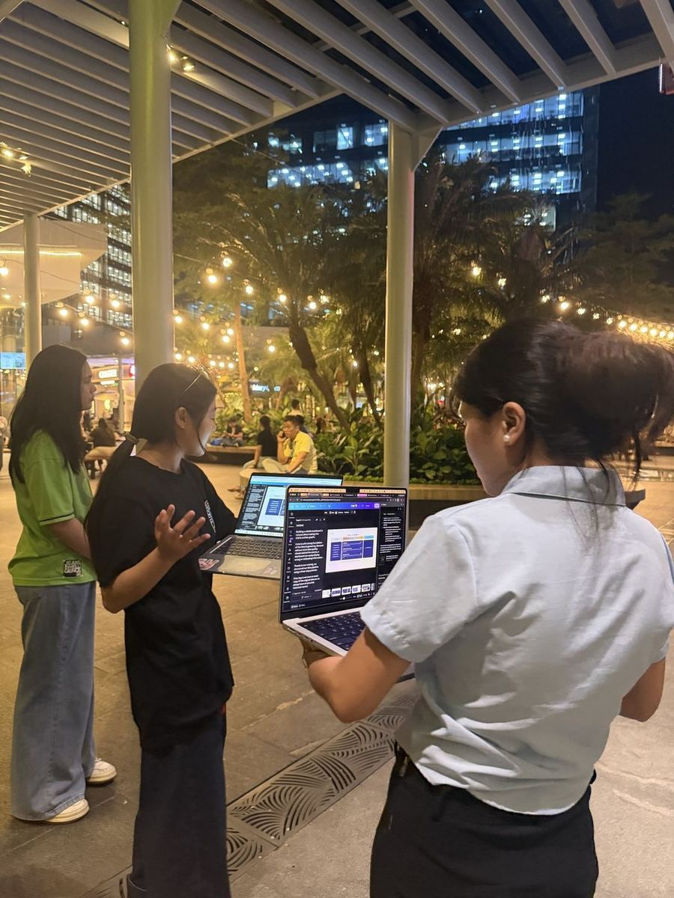
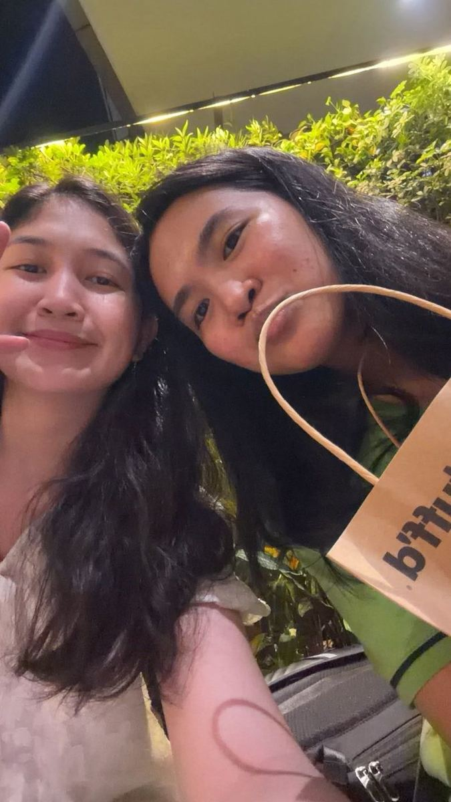
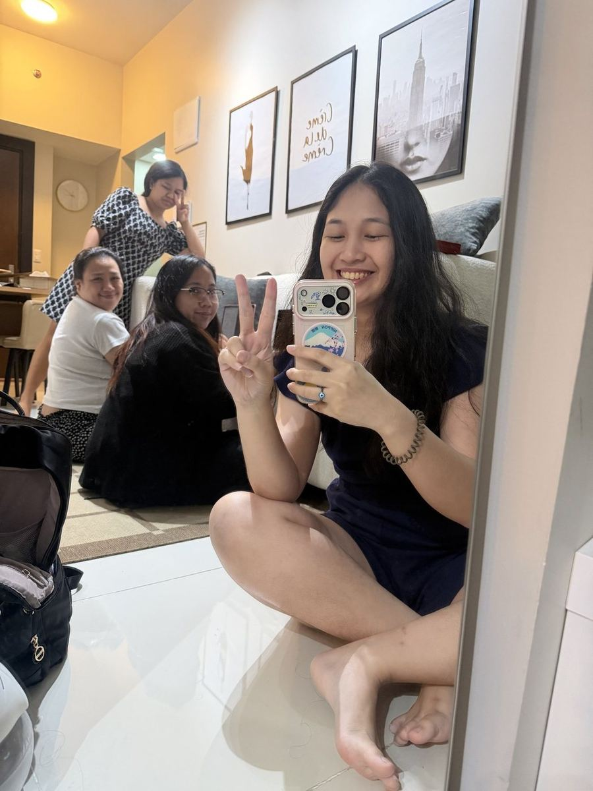
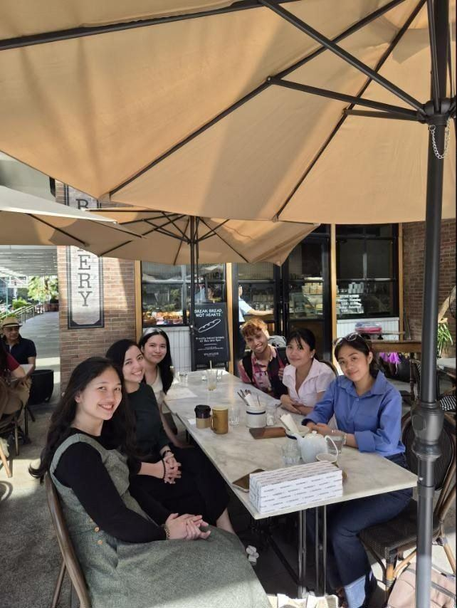
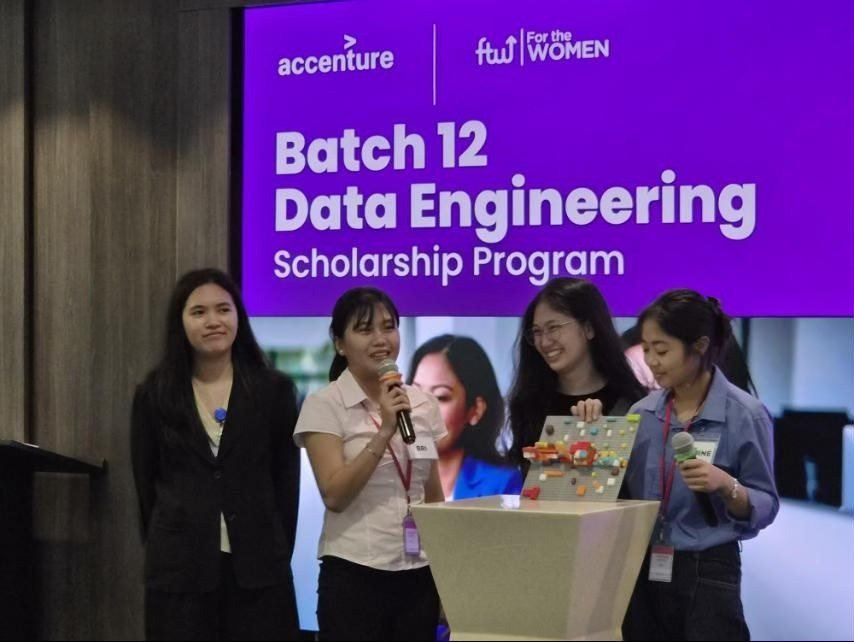

# Journal - 2026-10-17 - Day 13: Almost. One More Week.

**FTW Foundation Batch 12 x Accenture, Data Engineering Track.**

  

## Today in one sentence

- Week 13 was Databricks Builders Day on Friday straight from my AWS class, a mock presentation we gave with four people instead of five, and a Saturday that ended with us building a bridge out of toy bricks because our capstone is about public works.

---

One Saturday left after this one.

This was the week where the thing we have been building stopped being a school project and started being something we had to stand up and defend. Twice. Once in front of each other, once in front of mentors.

Short version: almost.

<b>You: run log first, please</b>

 

| Step | When | What happened |
|---|---|---|
| 1 | Fri, daytime | AWS class in Alabang |
| 2 | Fri, afternoon | Straight to the Accenture office in BGC for Databricks Builders Day |
| 3 | Fri, evening | New Databricks features, and the community that uses them |
| 4 | Fri, evening | FTW with the Databricks team |
| 5 | Fri, night | Practised our mock presentation outside Uptown Mall |
| 6 | Fri, 12 AM | Ended the night waiting with Sam for her ride |
| 7 | Fri, after | Shared Airbnb with Jemma, Shiena and Vee |
| 8 | Sat, morning | Breakfast at Wildflour, Ms. Carmi's invitation. Kamustahan with Sir Simonee |
| 9 | Sat | Mock capstone presentation. Four of us, not five |
| 10 | Sat | Bricks and ten minutes. We built a bridge and a building |

Now the long version.

---

## What I learned

### 01 Alabang to BGC in one day

Friday started with my AWS re/Start class in Alabang and ended at the Accenture office in BGC for Databricks Builders Day. One city, two programs, one very long commute.

I am not complaining. I signed up for both.

---

### 02 Builders Day, and seeing the people behind the platform

We got to hear about the new features, which was the official reason to be there. The part that actually landed was different.

For thirteen weeks Databricks has been a thing I log into. On Friday it was a room full of people who build it and people who use it to do their jobs. Our capstone runs on their platform. Standing in that room made the whole thing feel less like homework.

> [!NOTE]
> A thing I keep forgetting: everything we build sits on something somebody else built. Worth meeting them occasionally.

---

### 03 Practising outside a mall, with four people

That night we practised for the mock presentation. Outside Uptown Mall, in the open, with people walking past. It was the space we had, so it was the space we used.

One of our team could not be there. So the four of us split her part between us and presented everything we had learned, as much of it as we could carry.

WARN. We got through it. It was not smooth and I will not pretend it was.

> [!IMPORTANT]
> If one person can hold a section alone, the team cannot. Everybody should be able to say the whole story badly rather than one section perfectly.

---

### 04 Twelve AM, waiting for a ride

We ended around 12 AM, waiting with Sam until her ride came.

There is no lesson here. I am putting it in because it is the part I remember.

---

### 05 The Airbnb, and the three weeks before it

Then back to our shared Airbnb with Jemma, Shiena and Vee. My core friends from this program, the ones I shared three weeks with.

We are in different capstone groups now, so this is the version of each other we get.

---

### 06 Breakfast, and a kamustahan

In the morning Ms. Carmi invited us to breakfast at Wildflour. Sir Simonee came too, and we got a quick kamustahan in before the day started.

Our mentors keep doing this. Feeding us and asking how we are, in that order.

---

### 07 Bricks, ten minutes, and a bridge

At the mock presentation they gave each team a pile of bricks and ten minutes.

We built a bridge and a building. Because DPWH. Because that is what our capstone is about.

What we handed in was a construction in progress, which is exactly where our capstone was that day. Not finished. Standing up, though.

> [!IMPORTANT]
> Nobody told us to make it match our project. We did it anyway, which told me the story had finally gotten into our heads.

---

## Terms I am still learning

| Term | What I think it means today |
|---|---|
| Mock presentation | A dress rehearsal where the feedback is free and the stakes are not |
| Bus factor | How many people can leave before the team stops working. Ours was too low on Friday |
| Lakehouse | The thing I have been logging into for thirteen weeks, built by people I finally met |

## What confused me

- How to rehearse a fifteen-minute story without it sounding rehearsed. Every run made it smoother and a little more dead.
- Whether covering for a missing teammate well is a good sign or a warning sign. I think it is both.

## One small next step

- [ ] Make sure every one of us can tell the whole KITA story end to end, badly, without notes

## Git checkpoint

- [x] I created or updated a file
- [x] I wrote a commit
- [x] I pushed my changes

## Evidence from today

- Databricks Builders Day, Accenture BGC, 16 October
- The mock presentation deck, four voices instead of five
- A bridge made of bricks, since demolished

## Reflection

Last week I practised being chosen. This week I practised being ready, which turns out to be a different muscle.

The bricks thing is the bit I keep thinking about. Given ten minutes and no instructions, we built the thing we had spent four weeks reading about. It was under construction, and so were we.

## Mood or meme

Four people doing five people's presentation outside a mall at 10 p.m. while strangers walk past. Nobody looked up. Perfect audience.

---

<b>You: and the part that was not in the lessons</b>

 

Sharing a place with Jemma, Shiena and Vee again. Three weeks of my life were mostly these three, and then capstone groups split us up.

You do not get that time back, so you take the Friday nights.

<b>You: so how does this end</b>

 

Depends who you are.

- If you are Nadine, Bri or Sam: thank you for carrying an extra fifth on Friday night.
- If you are Tricia: we had you covered. See you at the finish.
- If you are Ms. Carmi or Sir Simonee: thank you for the breakfast and the kamustahan.
- If you are Jemma, Shiena or Vee: different groups, same batch, still my people.
- If you are me at 1 a.m.: one Saturday left. The bridge is standing. Finish it. Pet the cat. Go to sleep.

The rest of my commits will live here.
