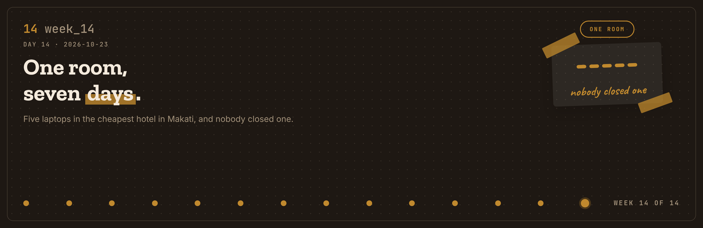
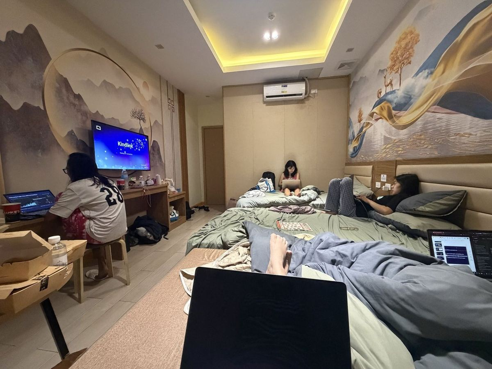
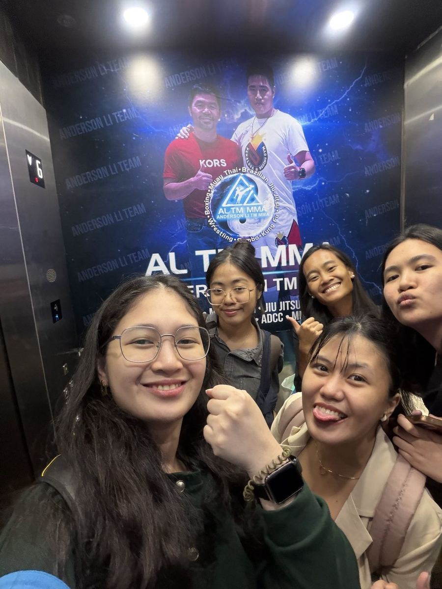
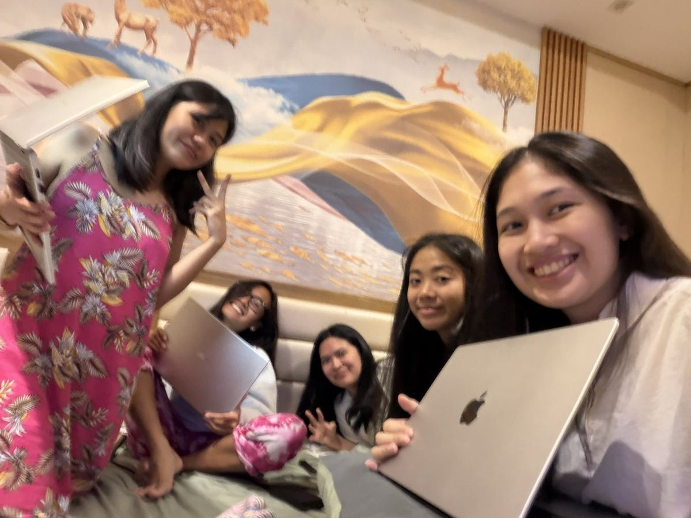
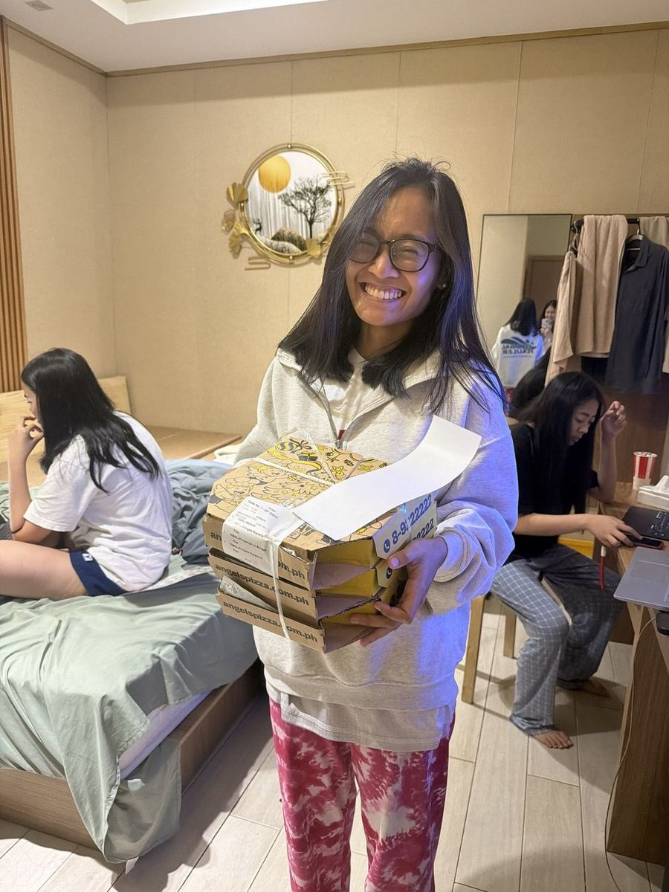
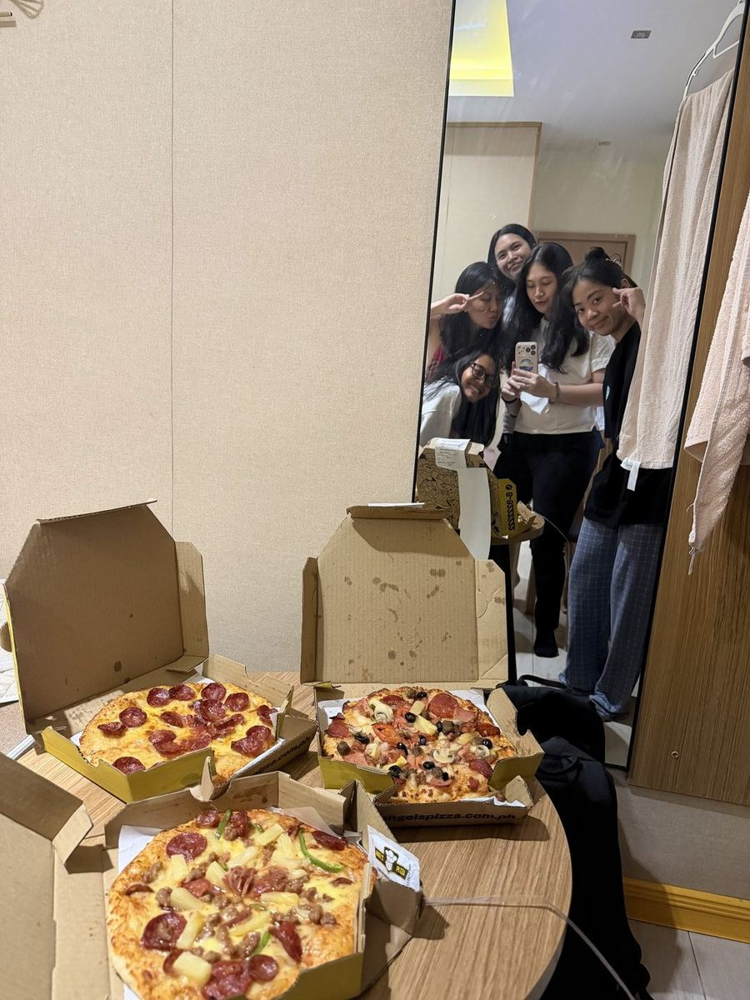
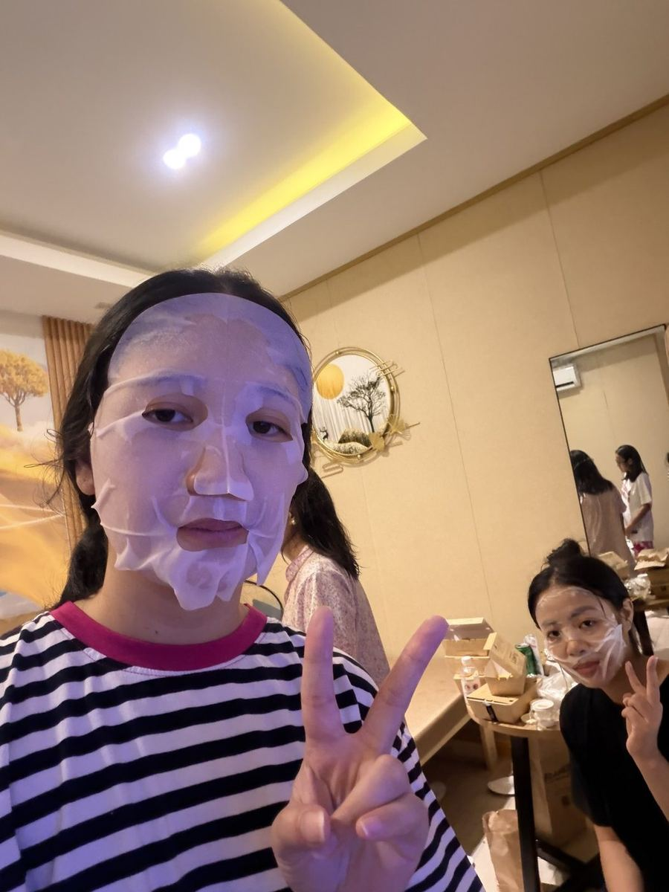
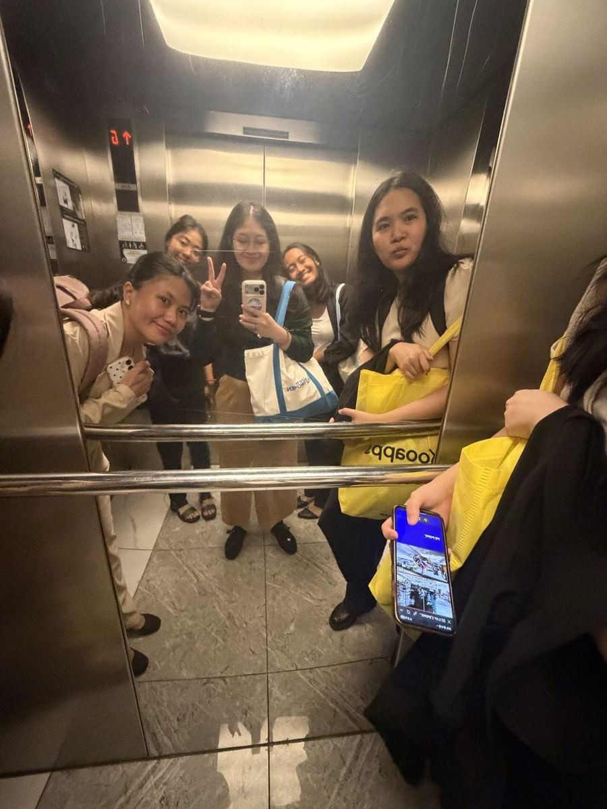

# Journal - 2026-10-23 - Day 14: One Room, Seven Days

**FTW Foundation Batch 12 x Accenture, Data Engineering Track.**

  

## Today in one sentence

- The five of us moved into the cheapest hotel room we could find in Makati seven days before capstone day, and the week turned out to be less about building anything and more about deciding which parts of our own work we were going to leave out.

---

This one does not have a Saturday. It has a week.

Capstone day is tomorrow. We spent the seven days before it in one room, and I am writing this the night we checked out, while I can still remember it properly.

Short version: it got done.

<b>You: run log first, please</b>

 

| Step | When | What happened |
|---|---|---|
| 1 | Sat 17, after the mock | Booked the cheapest room we could find in Makati |
| 2 | check in | Five of us, five laptops, one room |
| 3 | all week | Finished the dashboards |
| 4 | all week | Finished the GitHub documentation |
| 5 | all week | Argued about the story. This took the longest |
| 6 | around dinner | Ms. Tina sent pizza. Three boxes |
| 7 | past midnight | Used Ms. Michelle's face masks, ran the deck again |
| 8 | one night | A hard conversation that needed to happen |
| 9 | check out | Dashboards built, documentation written, a story we agreed on |

Now the long version.

---

## What I learned

### 01 The room

It was the cheapest place we could find and it looked exactly that cheap. We booked it anyway. We were not going there to sleep.

Seven days before we had to present, we checked in and basically did not leave.

---

### 02 Five laptops, and nobody closed one

Here is what I thought the week would be: finish the dashboards, finish the GitHub documentation, rehearse, go home.

Two of those were true.

The dashboards got finished. The documentation got finished. CI stayed green. Every change still went through a pull request, even at 2 a.m., which I am proud of in a way that is probably not normal.

- [x] KITA dashboard, five pages
- [x] Repository documentation and the data access guide
- [x] Decision log up to date
- [ ] Sleep

---

### 03 The week was about subtraction, not building

The thing that ate the week was not the code at all. It was the story.

We had six public datasets joined on three keys, 265,582 DPWH projects, and findings everywhere. Our mentors had already said the hard part out loud: you have too many findings, pick the two or three that actually matter.

So that is what the week became. Not building. Cutting. Five of us in one room arguing about which pieces of our own work would not make it into fifteen minutes.

That is harder than it sounds when everyone is proud of a different piece.

> [!IMPORTANT]
> A finding you cannot land in a sentence is a finding the room will not remember. We cut good work because it needed a paragraph.

---

### 04 Ms. Tina sent pizza

Somewhere around dinner, three boxes arrived at the door, for a team she was not required to feed.

We stopped for about twenty minutes. Ate, talked about things that were not the capstone, went back to the deck. It helped more than twenty minutes should.

---

### 05 Face masks at 1 a.m.

Ms. Michelle had given us face masks weeks earlier. We finally used them that week, late, in between run-throughs, with her notes on our presentation open on a laptop.

If we were going to look like that anyway, we might as well look like that with skincare on.

---

### 06 The night that was not soft

One night we had a conversation that was hard and that needed to happen. I am not writing the details, here or anywhere.

What I will write down, because it is the part worth keeping: everybody in that room was exhausted, and everybody stayed.

WARN, because it worked out and I still do not know how much of that was us and how much was luck.

---

### 07 Checking out

Then it was done. We checked out with the dashboards built, the documentation written, and, finally, a story all five of us agreed on.

---

## Terms I am still learning

| Term | What I think it means today |
|---|---|
| Scope cut | Deleting good work on purpose because the audience has fifteen minutes |
| Decision log | The file that stops the same argument happening twice |
| STOP vs FLAG | A STOP check blocks the next step. A FLAG records a known limit and keeps it visible |

## What confused me

- How to tell the difference between a finding that is genuinely important and a finding I am attached to because I built it.
- Whether we should have booked somewhere better. We saved money and lost sleep. I still do not know the right answer.

## One small next step

- [ ] Sleep before tomorrow. Non-negotiable.

## Git checkpoint

- [x] I created or updated a file
- [x] I wrote a commit
- [x] I pushed my changes

## Evidence from today

- KITA dashboard, five pages, final build
- Repository documentation and data access guide, merged
- Decision log, 57 entries with a date and a reason each

## Reflection

I went into the week expecting it to be a build week. It was an editing week.

Fourteen weeks of learning how to make things, and the last one was spent learning how to leave things out. I did not see that coming and I think it is the most useful thing the program taught me.

## Mood or meme

Five women, one cheap hotel room, three pizza boxes and a pull request at 2 a.m. Nobody closed a laptop.

---

<b>You: and the part that was not in the lessons</b>

 

The twenty minutes around the pizza. We stopped being a team with a deadline and were just five people in a room for a bit.

I will remember that longer than I remember the slides.

<b>You: so how does this end</b>

 

Depends who you are.

- If you are Nadine, Bri, Sam or Tricia: one room, seven days, nobody left. Thank you.
- If you are Ms. Tina: the pizza, and the sponsor questions that shaped the whole story.
- If you are Ms. Michelle: the face masks and the notes. Both got used.
- If you are Ms. Carmi: tomorrow is the one you have been getting us ready for.
- If you are me at 1 a.m.: it is done. Say it clearly tomorrow. Pet the cat. Go to sleep.

The rest of my commits will live here.
