# Journal - 2026-10-24 - Day 15: Capstone and Graduation Day

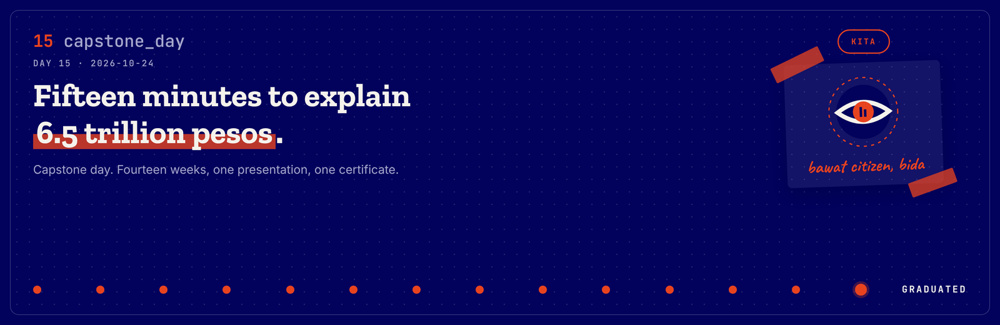

**FTW Foundation Batch 12 x Accenture, Data Engineering Track.**

  

## Today in one sentence

- We presented KITA to a room that included our sponsors, found out some of them were also our judges, got asked the hardest question of the program by Ms. Michelle, and then graduated.

---

This is the last entry of the program. Fourteen weeks, one room, one presentation, one certificate.

I am writing it the way I wrote all the others, which is to say badly and honestly, at night.

Short version: we made it.

<b>You: run log first, please</b>

 

| Step | When | What happened |
|---|---|---|
| 1 | morning | Last run-throughs. Not memorising, working out how to say it |
| 2 | on arrival | We surrendered our FTW IDs |
| 3 | morning | Checked on the other teams. Nobody had slept |
| 4 | morning | Ran the whole program start to finish |
| 5 | morning | Met our sponsors from Accenture. Some of them were our judges |
| 6 | morning | Our families and friends arrived |
| 7 | presentations | Six teams. We went fifth, second to the last |
| 8 | our slot | Presented KITA in fifteen minutes |
| 9 | Q&A | Ms. Michelle: "Is this true data?" |
| 10 | awards | Nella received the Above and Beyond Award and gave the speech |
| 11 | end | Certificates, flowers, class photo |
| 12 | 1 Nov | Passed the Databricks Certified Data Engineer Associate exam |

Now the long version.

---

## What I learned

### 01 The morning, and giving back the ID

We spent the morning not quite memorising. More like working out how to say fourteen weeks in fifteen minutes and still have it come out as a story.

When we arrived we surrendered our FTW IDs. That was the thing that made it feel real, more than the sashes did.

I went around checking on the other teams. The only thing we all had in common was that nobody had slept enough.

---

### 02 Our sponsors were our judges

We met our sponsors from Accenture that morning, and it turned out some of them were also sitting on the panel. Ms. Elena Flores and Sir Marlon among them.

It changes how you present when the people who funded the program are the ones asking the questions.

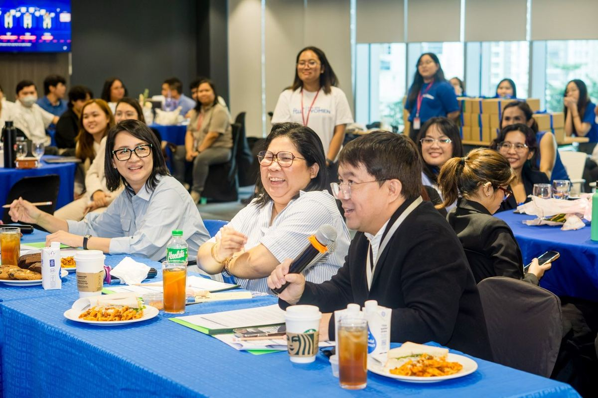

---

### 03 Second to the last

Six teams. PondoLens, ReachEd, Ahon, break, LUNASaan, then us, then GitAway.

We were fifth. Which means the nerves had five whole presentations to sit in. WARN purely for what that did to my stomach.

---

### 04 KITA, in fifteen minutes

Knowledge and Infrastructure Transparency Analytics. In Filipino, kita means visible.

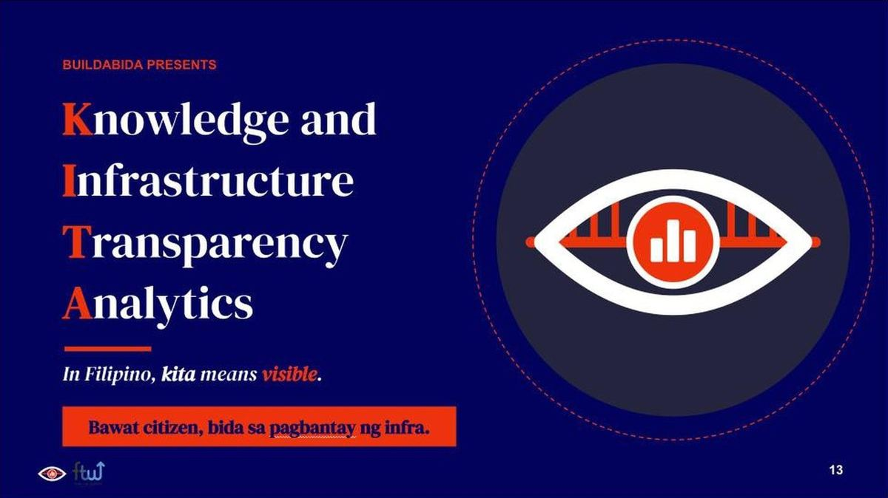

The business question: how can DPWH better monitor where its infrastructure investments go? We broke it into three.

| Question | What it asks |
|---|---|
| 1 | Where is the money going? |
| 2 | What are we building? |
| 3 | Who are we leaving behind? |

The build, in one table:

| Layer | What it holds |
|---|---|
| Bronze | Each source as published, with lineage |
| Silver | Cleaned, matched, reconciled. No guessed matches |
| Gold | Six dimensions, three facts, stable keys |
| Analytics | Six governed views by region and province |
| Dashboard | KITA, five pages |

265,582 DPWH projects, 2016 to 2026. 6.5 trillion pesos of recorded budget. Six public datasets joined on three keys: the PSGC place code, the contract ID, and the map point. 566 checks passed and none failed across the final runs.

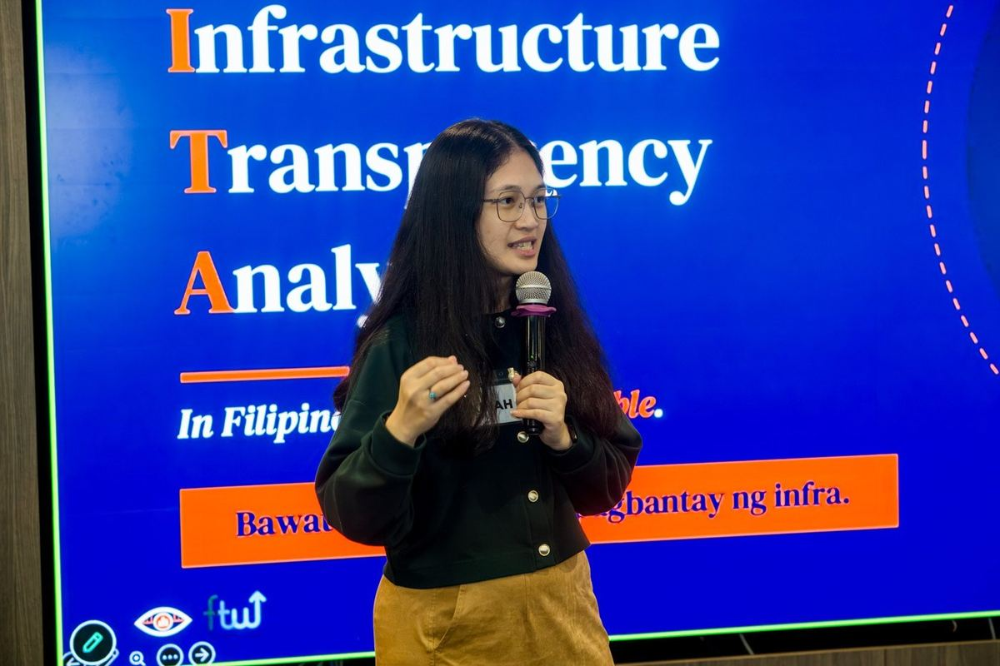

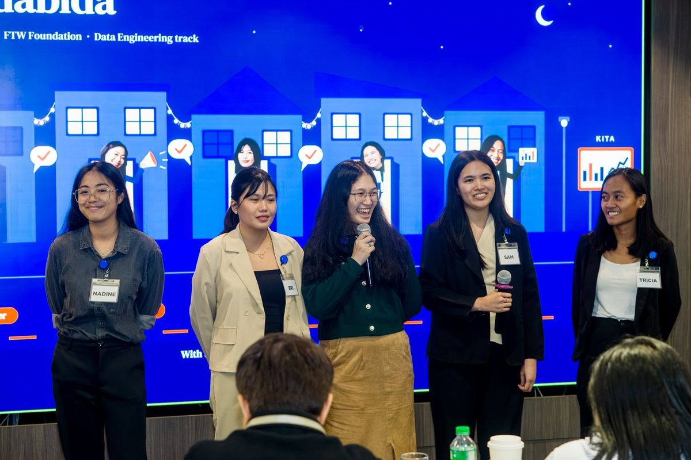

---

### 05 The hardest question of the program

Then Ms. Michelle asked:

> Is this true data?

At first we thought she was asking whether we had the real data. She asked again. That is when it landed.

We got it from the DPWH portal. But when we fact-checked against the news, we saw how dirty it was. About 50,000 projects with no map point. Budgets with no payments recorded against them. Projects still sitting as ongoing years later. The record is public, and public does not mean anyone can make sense of it.

Which is exactly why our recommendations were addressed to DPWH, not to our audience.

> [!IMPORTANT]
> This is the lesson of the whole program for me. A data engineer does not just move data from one place to another. You are allowed to question it. You are supposed to. The data will always be dirty, and someone has to say so out loud and then make it usable anyway.

---

### 06 What we asked DPWH for

Three things to add to the portal:

1. Exact measurements. Road length in kilometres, building size in square metres, so cost per unit can be compared.
2. A target date beside the actual finish date, so real delays can be measured instead of estimated.
3. Itemised records of money paid, not only budgets.

And three ways to use KITA now: check delivery first in long-running and stalled projects, bring population and flood risk into allocation reviews, and make review a cycle rather than a one-off.

---

### 07 Nella's speech

At the end, Nella received the Above and Beyond Award and gave a speech that ruined all of us.

She talked about this room. That what everyone was seeing that day was only the output, and the real thing was the fourteen weeks behind it. The journey. The sisterhood.

We were ugly crying with full makeup on. She told it so well.

---

### 08 Certificates

Thirty-one of us graduated.

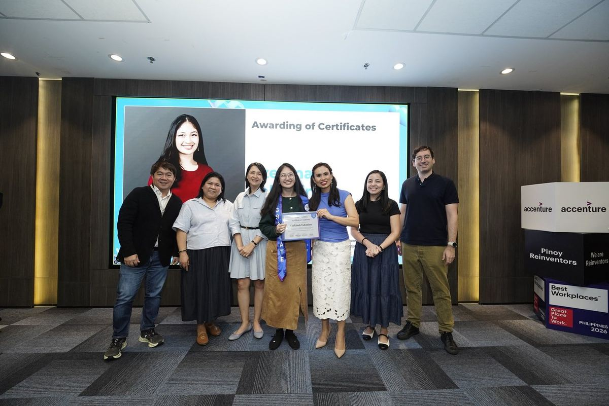

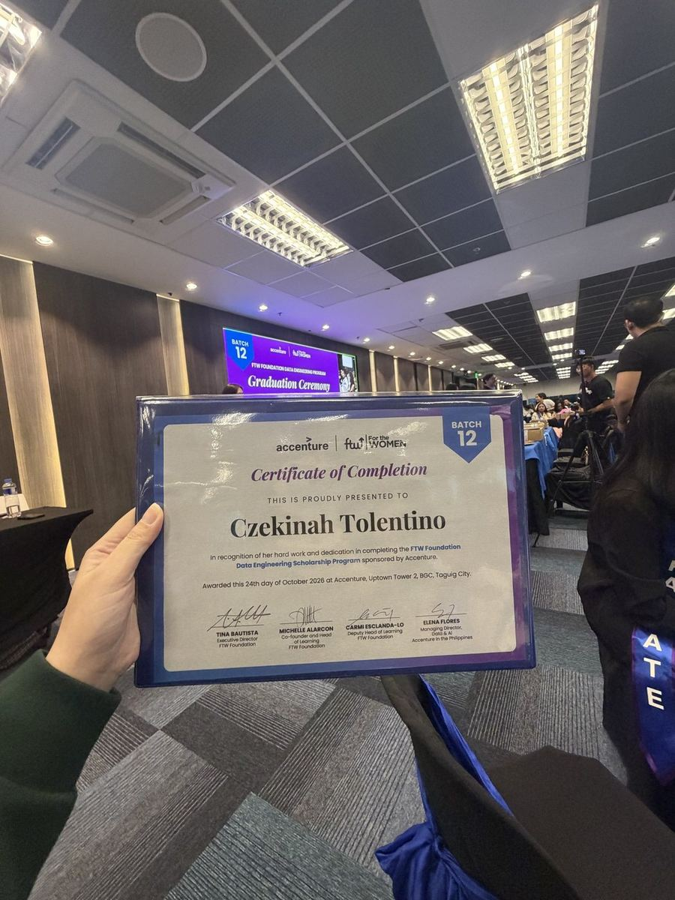

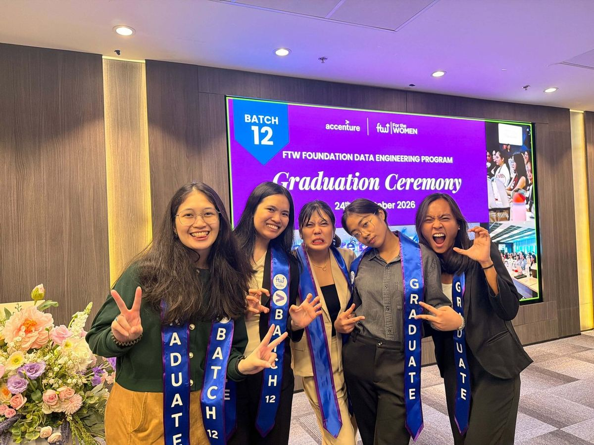

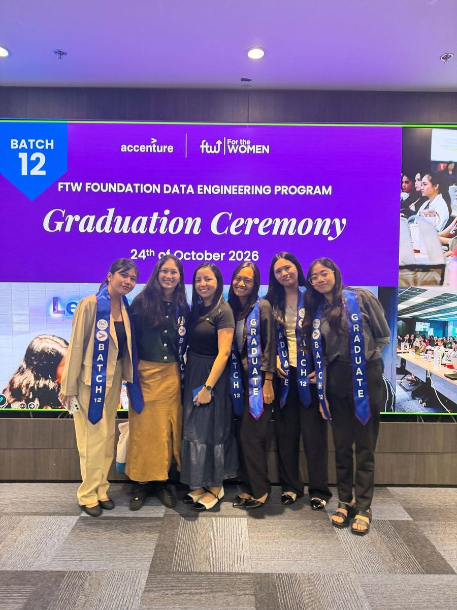

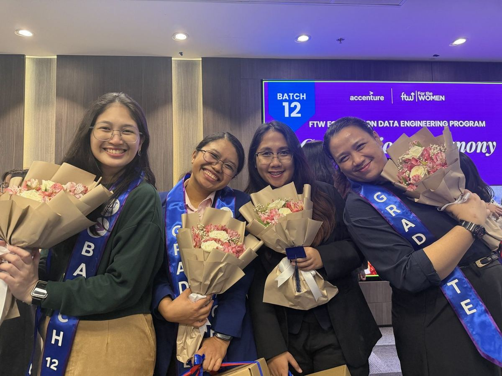

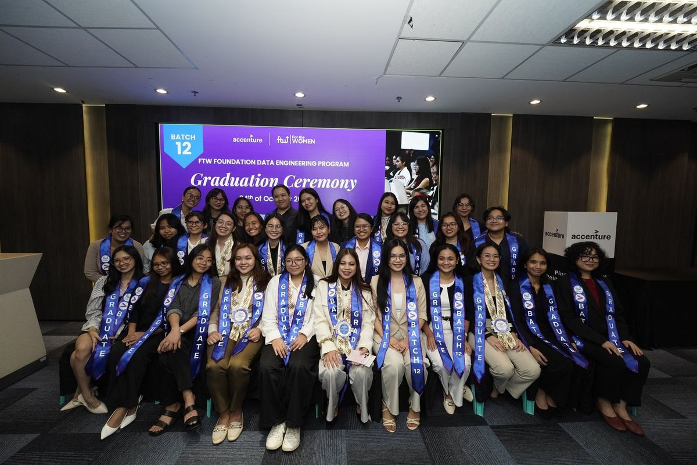

---

### 09 One week later

On 1 November I passed the Databricks Certified Data Engineer Associate exam.

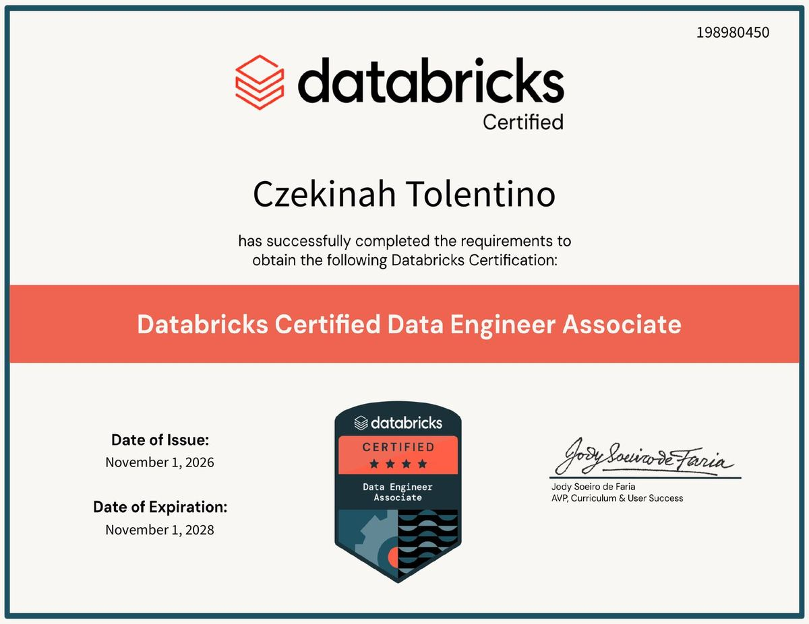

---

## Terms I am still learning

| Term | What I think it means today |
|---|---|
| True data | Not "did you get the real file". Do you know what is wrong with it |
| Governed view | A query people are allowed to trust, because something checked it first |
| Lineage | Being able to say which file a number came from, and when |

## What confused me

- Nothing today. For once the confusion came before, not during.
- Except this: I still do not know whether anybody at DPWH will ever read our recommendations. I would like them to.

## One small next step

- [x] Pass the Databricks exam
- [ ] Keep the journal going past the program

## Git checkpoint

- [x] I created or updated a file
- [x] I wrote a commit
- [x] I pushed my changes

## Evidence from today

- KITA capstone executive summary, two pages
- Repository: https://github.com/Buildabida/infra-project-monitoring
- FTW Foundation certificate of completion, 24 October 2026
- Databricks Certified Data Engineer Associate, credential 198980450, issued 1 November 2026

## Reflection

Fourteen weeks ago I described a data engineer as someone who moves data from one place to another. I wrote that down on day one because somebody asked.

Today a mentor asked me whether our data was true, and I had an answer, and the answer was not yes.

That is the distance.

## Mood or meme

Fifteen minutes, 6.5 trillion pesos, one question I did not see coming, and a room full of women crying in full makeup.

---

<b>You: and the part that was not in the lessons</b>

 

The people we invited. The ones who watched us study at home for fourteen weeks and know exactly what this looked like from the outside.

They did not see the pipeline. They saw the Saturdays.

<b>You: so how does this end</b>

 

Depends who you are.

- If you are Nadine, Bri, Sam or Tricia: we built it, we cut it, we said it. Buildabida.
- If you are Ms. Carmi: you got us here. Thank you for every review.
- If you are Ms. Tina or Ms. Michelle: thank you for the sponsor feedback, and for the question I will be chewing on for years.
- If you are Ms. Elena Flores or Sir Marlon: thank you for sitting through all six of us.
- If you are Ms. Ferl, Sir Simon or Ms. Jo: thank you for the whole fourteen weeks.
- If you are Nella: you said it better than any of us could have.
- If you are Batch 12: thirty-one. All of us.
- If you are me at 1 a.m.: it is finished. The journal is not. Pet the cat. Go to sleep.

That was the last Saturday. The commits keep going.
